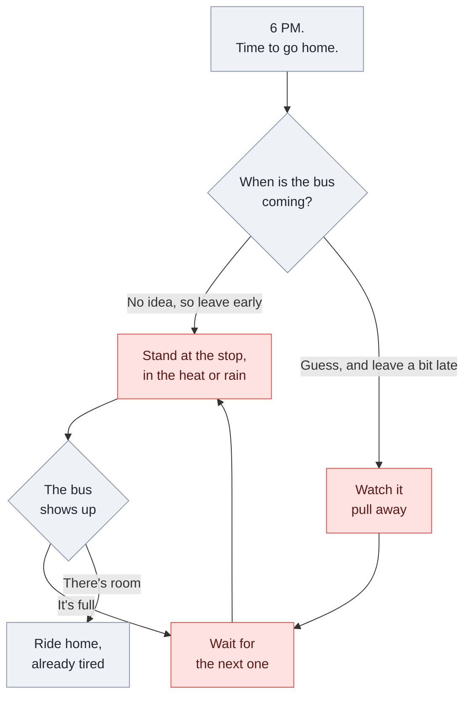
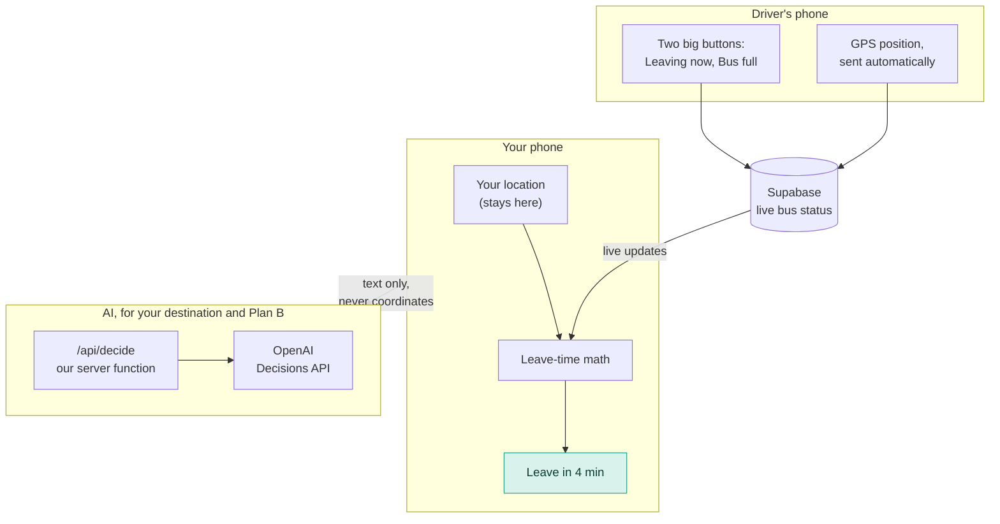
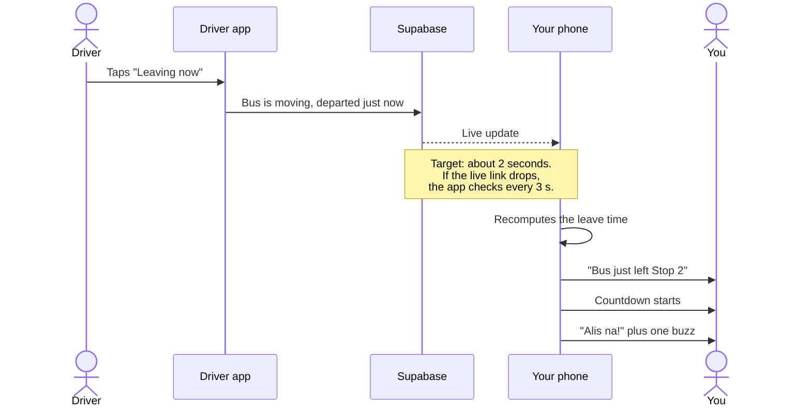
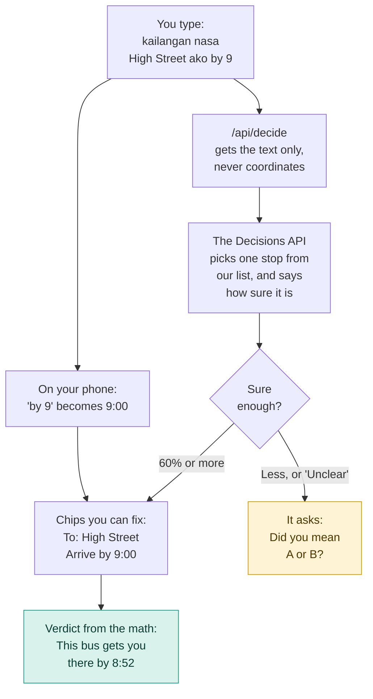
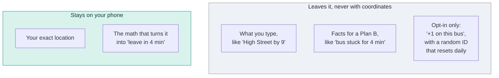
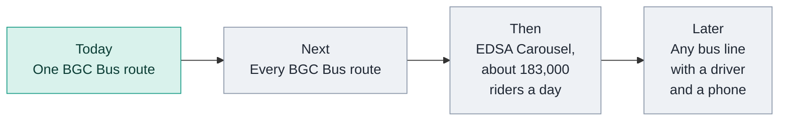
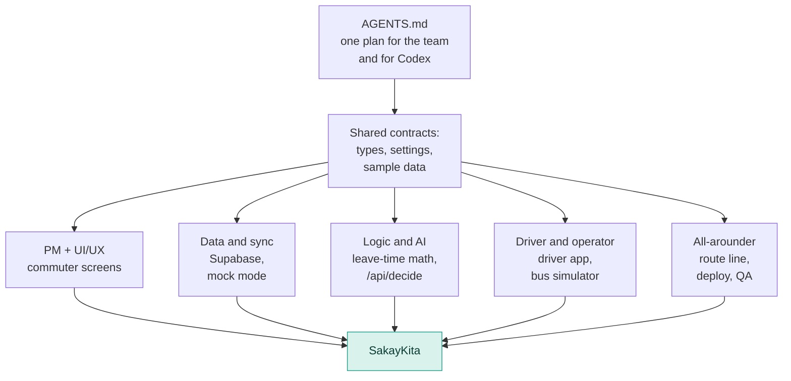

<div align="center">

# SakayKita

### Stop waiting at the stop. We tell you exactly when to leave.

A bus app for BGC commuters that answers one question at a glance: **"When do I leave?"**

**Live app:** [add link] &nbsp;·&nbsp; **Demo video:** [add link] &nbsp;·&nbsp; **Build plan:** [AGENTS.md](AGENTS.md)

<sub>Built in one afternoon at the Codex × UX+AI Hackathon, 25 October 2026.</sub>

</div>

---

## The short version

- **The problem:** You can't tell when the bus will actually come, so you leave early and stand at the stop. Or you leave a little late and watch it pull away.
- **Our fix:** The driver's phone becomes the tracker. Your phone turns that into one number: **leave in 4 min**.
- **When things go wrong:** If the bus is late, full, or already gone, you get a Plan B while you're still at your desk.
- **The AI:** It works out where you're going and picks the best Plan B. It shows how sure it is, and you can always change its answer. The countdown itself is plain math.
- **Privacy:** We track buses, not people. Your location never leaves your phone.

---

## The problem

It's 6 PM. You pack up, ride the elevator down, and walk to the stop. The bus could be two minutes away or twenty. You have no way of knowing, so you play it safe: go early, then wait. Standing, in the heat or the rain.

*Pagod ka na, hindi ka pa nakakasakay.* You're already tired, and you haven't even boarded.

### Why it keeps happening

1. **A schedule is an average.** Rush-hour traffic doesn't follow it, so "a bus every few minutes" can turn into a long wait.
2. **A parked bus tells you nothing.** A bus sitting at a stop might leave in 30 seconds or in 5 minutes. On a map, both look exactly the same. Only the driver knows.
3. **Even a live map leaves the math to you.** How far is the bus, how fast is it going, how long is your walk? Nobody works that out at their desk, so people leave early just in case.
4. **Bad news shows up late.** You find out the bus is full or stuck once you're already at the stop, which is the worst place to make a new plan.



### What it costs

Here's one ordinary evening, done two ways. The times are made up but realistic. In both, the bus reaches the stop at 6:08. The only difference is when you knew it was coming.

```mermaid
gantt
    title One evening, two ways
    dateFormat HH:mm
    axisFormat %H:%M
    section Today
        Walk to the stop          :t1, 17:50, 5m
        Stand and wait            :crit, t2, after t1, 13m
        Ride home                 :t3, after t2, 15m
    section With SakayKita
        Keep working              :s0, 17:50, 12m
        Walk to the stop          :s1, after s0, 5m
        Wait                      :crit, s2, after s1, 1m
        Ride home                 :s3, after s2, 15m
```



Same bus, same ride home. Thirteen minutes of standing at the stop become twelve more minutes at your desk and one minute of waiting.

Now multiply that:

- **BGC Bus** carries about **41,000 passengers a day**, based on BGC's own records (reported in 2017).[^bgc]
- **EDSA Carousel** carried **66.7 million passengers in 2025**, close to **183,000 a day**, according to DOTr.[^edsa]
- **Waiting is the worst part of the trip.** U.S. transit studies found that riders count a minute spent waiting as about **2.1 minutes** spent riding.[^tcrp]

Rough math, using our own assumption: if a heads-up saved each BGC Bus ride just 5 minutes at the stop, that's about **3,400 hours a day** that people don't spend standing around. On EDSA Carousel, it's over **15,000 hours a day**.

### Why it's worth solving now

- **The operator already cares.** When BGC redesigned its bus routes in 2017, it said the goal was "to help alleviate passenger wait time."[^bgc]
- **Nothing new has to be bought.** Drivers already carry phones. So do riders.
- **One decision is enough to start.** BGC Bus has a single operator, so one yes can switch this on for the whole fleet.

---

## How SakayKita works

Open the app and the answer is already there. No searching, no map to read, no taps. The home screen reads something like this:

> ### Leave in 12 min
> Bus is 2 stops away · 4 min walk to your stop
>
> `Live · 8s ago` &nbsp; `Seats likely · 2 riders reported` &nbsp; `Your location stays on this phone`

Here's how the pieces fit together:



### 1. The driver's phone is the tracker

The driver app sends the bus's GPS position on its own. The driver only deals with two big buttons:

- **Leaving now**, tapped when pulling away from a stop
- **Bus full**, tapped when there's no more room

The buttons lock while the bus is moving, so nobody taps while driving. It comes down to one tap per stop, made while stopped.

There are no GPS boxes to install. And because the data comes from drivers, not riders, the very first commuter who opens the app already gets a real answer.

Here's what happens when the driver taps:



### 2. Your phone does the math

Your phone downloads where the buses are, finds your nearest stop, and works out the rest on the device:

```text
leave in  =  bus reaches your stop  −  your walk  −  1 min buffer
   4 min  =         9 min           −    4 min   −     1 min
```

- **Your walk:** the distance to your stop, plus 25% because streets aren't straight lines, at an easy walking pace of about 4.3 km/h.
- **The bus:** the distance it still has to cover, at about 15 km/h in traffic, plus 30 seconds for each stop along the way.
- **A bus parked at a stop:** we count it as if it left right now and say "or later," because that's the honest answer until the driver taps **Leaving now**.

These speeds are starting assumptions that we tune, not measured values. Tap the big number in the app and it shows you this same breakdown, along with where the data came from and how old it is.

The screen also tells you how fresh the data is: `Live · 8s ago`, `Updated 1 min ago`, or `Schedule estimate`. Crowding shows up as a level, like `Busy · 5 riders reported`, never as a made-up passenger count.

### 3. A Plan B before you need one

When something goes wrong, a card slides up with one clear alternative:

| What went wrong | What we suggest |
|---|---|
| You won't make this bus | Take the next one |
| The driver marked it full | Take the next one |
| The bus has been stuck at a stop for over 3 minutes | Walk, or book a ride |
| No live signal from the bus | Use the schedule, and say clearly that it's an estimate |

### Every screen, in plain words

| What's happening | What the screen says | With a Filipino touch |
|---|---|---|
| Plenty of time | Leave in 12 min | Chill ka muna |
| Almost time | Leave in 4 min | Maghanda na |
| Time to go | Leave now | **Alis na!** |
| Bus still waiting at a stop | Leave in ~6 min or later | Naghihintay pa ang bus |
| Too late for this one | You'll miss this one | Hindi na aabot |
| Bus is full | This bus is full | Puno na |
| Bus is stuck | Bus is running late | Na-delay ang bus |
| No live bus | A bus comes every ~10 min | Walang live na bus |

When it's time to go, the top of the screen switches to a strong warning color, the number becomes **Alis na!**, and the phone buzzes once. You can't miss it.

---

## The AI: it understands, the math decides

We use AI for the two things simple rules do badly: understanding how people actually type, and weighing a messy situation. We don't let it touch the countdown. Time stays plain math, so it's always explainable.

### Job 1: Where are you going?

Type it the way you'd text a friend: *"kailangan nasa High Street ako by 9"* (I need to be at High Street by 9).



- The AI can only pick from the stops on the route. It can't make one up.
- If it isn't sure, it asks you instead of guessing.
- "By 9" is read on your phone with a simple pattern. No AI needed for that.

### Job 2: What should I do now?

When the bus is late or full, the AI chooses between **keep waiting**, **take the next bus**, **walk**, or **book a ride**. It only sees facts, like this:

> Bus has been stopped at Stop 3 for 4 minutes. Driver marked the bus full. Next bus in about 10 minutes. Walking to Stop 6 takes 14 minutes. Commuter must arrive by 9:00; it is 8:41. Commuter note: "may dala akong mabigat" (I'm carrying something heavy).

That last line is where AI earns its place. A heavy bag changes the right answer, and the AI can weigh that. A simple rule can't. The app shows its pick, one line on why, and keeps the other options one tap away.

### Why a decision instead of a chatbot

Commuters need an answer, not a paragraph. OpenAI's Decisions API picks from answers we define and returns a confidence score, so the app can show how sure it is and step back when it isn't. Every request goes through our own server function, so the API key stays on the server and your coordinates are never part of it.

If the Decisions API isn't available, the same endpoint falls back to OpenAI's Responses API with a fixed list of allowed answers, and then to simple keyword rules. The app keeps working even with no AI at all.

---

## Private by design

**We track buses, not people.**



- Your phone uses your location to find your nearest stop and your walking time. Your coordinates are never sent to our server or to any AI model.
- The AI only ever sees text: what you typed, or plain facts about the trip when it's choosing a Plan B.
- If you choose to help others see how full the bus is, your phone sends only "+1 on this bus" with a random ID that changes daily. No account, no coordinates.
- You can check this yourself: open your browser's network tab. No request carries your coordinates.

---

## How it's different

Most transit apps answer *"Where is the bus?"* SakayKita answers *"When do I leave?"*

| | A typical bus tracker | SakayKita |
|---|---|---|
| **Main screen** | A map with a moving dot | One number: when to leave |
| **Who does the math** | You | The app, and it shows its work |
| **A bus parked at a stop** | Looks the same whether it leaves in 30 seconds or 5 minutes | The driver taps **Leaving now**, so you know the moment it moves |
| **Where the data comes from** | GPS boxes the operator has to buy, or riders sharing their location | The driver's phone and two buttons |
| **On day one** | Rider-powered apps stay empty until enough people join | Works for the very first user |
| **When something goes wrong** | You find out at the stop | You get a Plan B at your desk |
| **How sure it is** | Usually doesn't say | Every number shows how old it is and how confident we are |
| **Your location** | Rider-powered apps depend on it | Never leaves your phone |
| **The AI** | Hidden, or a chatbot | Picks from fixed choices, shows how sure it is, and you can override it |

---

## Built to roll out



- **For the operator:** no hardware to buy, live data on where every bus is and how full it gets, and, we expect, a lot fewer "nasaan na ang bus?" complaints.
- **For drivers:** one tap per stop, only while stopped, on buttons big enough to hit without looking twice.
- **For safety:** the buttons lock whenever the bus is moving. GPS runs on its own.

---

## How we built it

Five of us built this in parallel in one afternoon, each working with Codex from the same plan.



- **One plan for people and AI.** [AGENTS.md](AGENTS.md) is the single source of truth. Every Codex session starts by reading it, so each one knows its role, its folders, and what not to touch.
- **Contracts first.** Shared types, settings, and sample data were locked in at the start. After that, nobody had to wait on anybody.
- **Sample data for every screen.** Each screen state has its own sample data, so the commuter screens could be built before the backend existed.
- **A mock mode that needs no internet.** Two browser tabs can play driver and commuter on one laptop, in case the venue Wi-Fi gives up.

**Codex highlights:** [add 2–3 moments from the Codex log, with screenshots]

---

## Run it yourself

```bash
npm install
npm run dev
```

Then open two tabs:

- `http://localhost:5173/driver` is the driver app. Triple-tap the route name to open the demo controls.
- `http://localhost:5173/?demo=1` is the commuter app, using a demo location instead of your GPS.

By default the app runs in **mock mode**. The two tabs talk to each other inside the browser, with no internet and no accounts needed.

**Live mode** (real phones, real sync) needs a Supabase project. Run the SQL from [AGENTS.md, section 7](AGENTS.md#7-role-backend-1-data-and-sync) once, then create a `.env.local` file:

```bash
VITE_DATA_MODE=live
VITE_SUPABASE_URL=your-project-url
VITE_SUPABASE_ANON_KEY=your-anon-key
# Optional: makes the simulated bus move faster during demos
VITE_TIME_SCALE=8
```

The AI runs as a Vercel function at `/api/decide`. Set `OPENAI_API_KEY` in your Vercel project settings. The key stays on the server and never reaches the browser. To run that function locally, use `npx vercel dev` instead of `npm run dev`. Without a key, the app uses its built-in rules.

### Project layout

```text
api/decide.ts              AI endpoint (the OpenAI key stays on the server)
src/contracts/             shared types, settings, and sample data
src/data/                  route stops, mock data, live data
src/logic/                 leave-time math, Plan B, crowd level
src/screens/commuter/      commuter app, at /
src/screens/driver/        driver app, at /driver
src/components/RouteLine/  the animated route line
```

### Built with

React, Vite, TypeScript, Tailwind CSS, motion, and lucide-react on the front end. Supabase (Postgres and Realtime) for live data, with polling as a backup. OpenAI's Decisions API for the AI inside the app. Vercel for hosting. Vitest for tests. Codex for building all of it.

---

## What's next

- Every BGC Bus route, in both directions
- EDSA Carousel and its 183,000 riders a day
- "I'm on this bus" detection that runs on the phone, so crowd levels fill in by themselves (opt-in, of course)
- Alerts that reach you even when the app is closed
- A simple dashboard for the operator

---

## Team

| Role | Name |
|---|---|
| PM, UI and UX | [add name] |
| Data and sync | [add name] |
| Logic and AI | [add name] |
| Driver app and operator story | [add name] |
| All-arounder: route line, deploy, QA | [add name] |

[^bgc]: "New bus routes, schedule in BGC by Aug. 7," *BusinessWorld*, 3 August 2017. [bworldonline.com](https://www.bworldonline.com/the-nation/2017/08/03/21435/new-bus-routes-schedule-bgc-aug-7/)
[^edsa]: "EDSA busway ridership hits over 66 million in 2025," *Philstar*, 13 January 2026, citing DOTr records of 66,669,287 passengers for the year. [philstar.com](https://www.philstar.com/nation/2026/01/13/2500557/edsa-busway-ridership-hits-over-66-million-2025)
[^tcrp]: *Transit Capacity and Quality of Service Manual*, 3rd edition (TCRP Report 165), Chapter 4, Exhibit 4-5. The U.S. average value of initial wait time is 2.1 times that of in-vehicle time. [onlinepubs.trb.org](https://onlinepubs.trb.org/onlinepubs/tcrp/tcrp_rpt_165ch-04.pdf)
